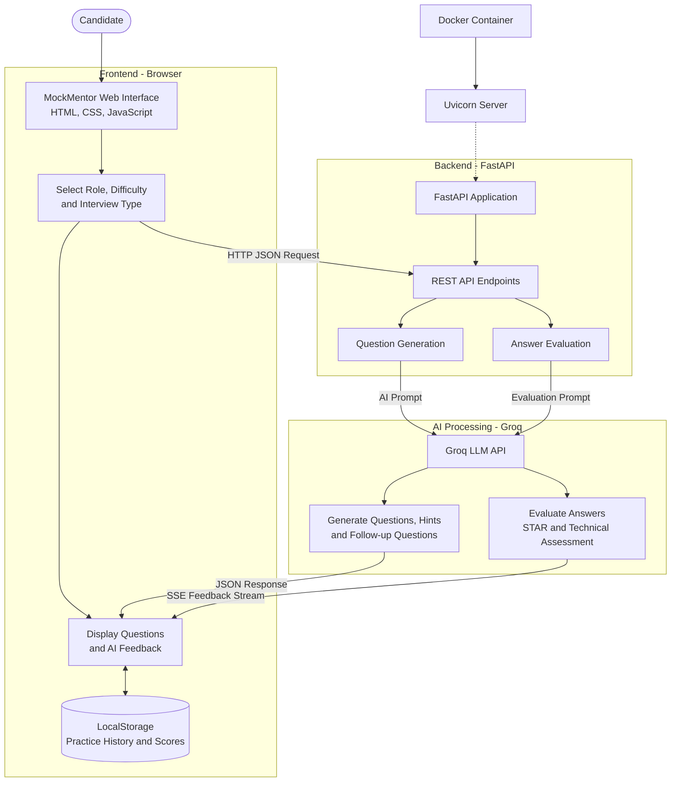

# MockMentor

**AI-Based Interview Preparation & Intelligent Answer Evaluation Platform**

MockMentor helps candidates prepare for technical, HR, and behavioral interviews through role-specific, AI-driven practice. Powered by Groq LLaMA 3, it generates interview questions and contextual follow-ups, evaluates responses, and provides structured scoring and personalized feedback, including STAR-based behavioral assessment.

MockMentor Live URL: http://interviewai-env.eba-qjkexinz.us-east-1.elasticbeanstalk.com/

---

##  Table of Contents

- [About](#-about)
- [Key Features](#-key-features)
- [System Architecture](#-system-architecture)
- [See MockMentor-AI in Action](#-see-mockmentor-ai-in-action)
- [Installation](#-installation)
- [Usage](#-usage)
- [Tech Stack](#-tech-stack)
- [Team](#-team)
- [Contributing](#-contributing)
- [Found a Bug?](#-found-a-bug)
- [License](#-license)

---

##  About

Candidates preparing for technical and behavioral interviews may have limited access to realistic practice tailored to a specific job role, difficulty level, and interview format. They may also struggle to identify weaknesses in their answers without consistent, structured feedback.

MockMentor is an interview preparation platform designed to address this challenge. Candidates select from six professional roles, choose an experience level and interview type, and receive AI-generated questions with hints and likely follow-up questions. The platform evaluates submitted answers and streams structured feedback, including STAR-based assessment for behavioral responses and technical accuracy and gap analysis for technical responses.

MockMentor also includes timed practice, in-session question history, performance scores, and browser-based daily progress tracking to help candidates review their strengths and areas for improvement.

**Why would you use MockMentor?**

- When you want to practice interviews without needing another person
- For getting honest, structured feedback on your answers instantly
- When you need role-specific questions (DSA, System Design, HR, Behavioural)
- For tracking your improvement across multiple practice sessions
- When you want to simulate the pressure of a real placement interview

---

##  Key Features

###  AI-Driven Interview Sessions
- Generates role-specific questions based on domain and difficulty
- Supports Technical, HR, and Behavioural interview types
- Multi-turn conversation — the AI follows up based on your answers

###  Real-Time Answer Evaluation
- Evaluates answers on clarity, depth, technical accuracy, and relevance
- Powered by Groq's LLaMA3-8B for sub-second inference
- Scores each answer and explains what was strong and what was missing

###  Structured Feedback
- Per-answer improvement tips, not just a score
- Identifies gaps in explanation and suggests better framing
- Highlights strong points so you know what to keep doing

###  Privacy by Design
- No answer data stored externally — all processing through secured API
- Environment variables used for all sensitive credentials
- No user tracking or third-party analytics

###  Performance
- Sub-second LLM responses via Groq inference engine
- FastAPI async backend handles concurrent sessions efficiently
- Docker container ensures consistent performance across environments

---


## System Architecture



### How We Handle AI Evaluation
- **Question Generation:** Role and difficulty sent to LLaMA3 via Groq API — question returned in <1 second
- **Answer Evaluation:** Your answer + the original question are sent together for contextual evaluation
- **Feedback Assembly:** The backend structures the raw LLM output into scored, readable feedback
- **Session Tracking:** Each interview session is tracked in memory (PostgreSQL persistence coming soon)

### Backend & Network
- **CORS Protection:** Only configured frontend origins can access the API
- **Environment Isolation:** API keys and secrets never hardcoded — loaded via `.env`
- **Dockerised Deployment:** Container isolates the runtime environment completely
- **Cloud Hosting:** AWS Elastic Beanstalk manages scaling and uptime automatically

### How Sessions Work
- **Start:** A new session ID is generated when you begin an interview
- **Mid-Interview:** Each Q&A pair is tracked within the session context
- **End:** Session summary compiled with overall performance insight
- **Clear State:** Closing the session wipes in-memory state — no residual data

---

##  See MockMentor-AI in Action

MockMentor Live URL: http://interviewai-env.eba-qjkexinz.us-east-1.elasticbeanstalk.com/

---

##  Installation

### Full Setup (Client and Server)

```bash
# Clone the repository
git clone https://github.com/Irin356/MockMentor-AI.git
cd MockMentor-AI
```

**Setup Server:**
```bash
cd backend
python -m venv venv

# Windows
venv\Scripts\activate
# Mac/Linux
source venv/bin/activate

pip install -r requirements.txt
```

**Configure environment:**
```bash
# Create .env file inside /backend
GROQ_API_KEY=your_groq_api_key_here
```
Get your free Groq API key at [console.groq.com](https://console.groq.com)

**Setup Client:**
```bash
cd ../frontend
npm install
```

---

##  Usage

### What You'll Need
- Python 3.11 or newer
- Node.js 18 or newer
- A free Groq API key from [console.groq.com](https://console.groq.com)
- A modern browser (Chrome, Edge, Safari)

### Running the Application

**Start the Server:**
```bash
cd backend
uvicorn main:app --reload --port 8000
```
API docs available at: `http://localhost:8000/docs`

**Start the Client:**
```bash
cd frontend
npm run dev
```
App available at: `http://localhost:5173`

### Using MockMentor AI

1. Open MockMentor-AI in your browser at `http://localhost:5173`
2. Select your interview type — Technical, HR, or Behavioural
3. Choose your domain (e.g. Data Structures, System Design, Python)
4. Pick a difficulty — Easy, Medium, or Hard
5. Read the question and type your answer in the response box
6. Hit **Submit Answer** — feedback appears within seconds
7. Continue to the next question or end the session for a summary
8. Review your overall performance and focus areas before your next practice

###  Running with Docker

```bash
# Build and start everything
docker-compose up --build

# Backend only
docker build -t mockmentor-ai ./backend
docker run -p 8000:8000 --env-file ./backend/.env mockmentor-ai
```

---

##  Tech Stack

PrepNova was built using:

- **Backend:** Python 3.11, FastAPI, Uvicorn
- **LLM Inference:** Groq API (LLaMA3-8B-8192)
- **Frontend:** React (Vite), Axios
- **Containerisation:** Docker, Docker Compose
- **Cloud:** AWS Elastic Beanstalk (EC2 + Load Balancer)
- **Database:** PostgreSQL
- **Config:** python-dotenv, Pydantic Settings

---

##  Contributing

We'd love to help make MockMentor-AI even better:

1. Fork this repository
2. Create your feature branch: `git checkout -b feature/your-feature`
3. Make your changes and test them
4. Commit: `git commit -m "Add your feature"`
5. Push: `git push origin feature/your-feature`
6. Open a Pull Request describing what you changed and why

---

##  Found a Bug?

For bugs or issues, please open a [GitHub Issue](https://github.com/Irin356/MockMentor-AI/issues) with:
- Steps to reproduce
- Expected vs actual behaviour
- Your OS and browser version

For security vulnerabilities, please report privately via GitHub's security advisory tab rather than opening a public issue.

---

##  API Considerations

- **Groq Free Tier:** Rate limits apply on the free plan — avoid rapid repeated submissions
- **Key Safety:** Never commit your `.env` file — it is already in `.gitignore`
- **AWS Costs:** Elastic Beanstalk uses EC2 — remember to terminate environments when not in use to avoid charges

---
License & Acknowledgments

This project is open source and available under the MIT License.

*Thank you for checking out MockMentor*
